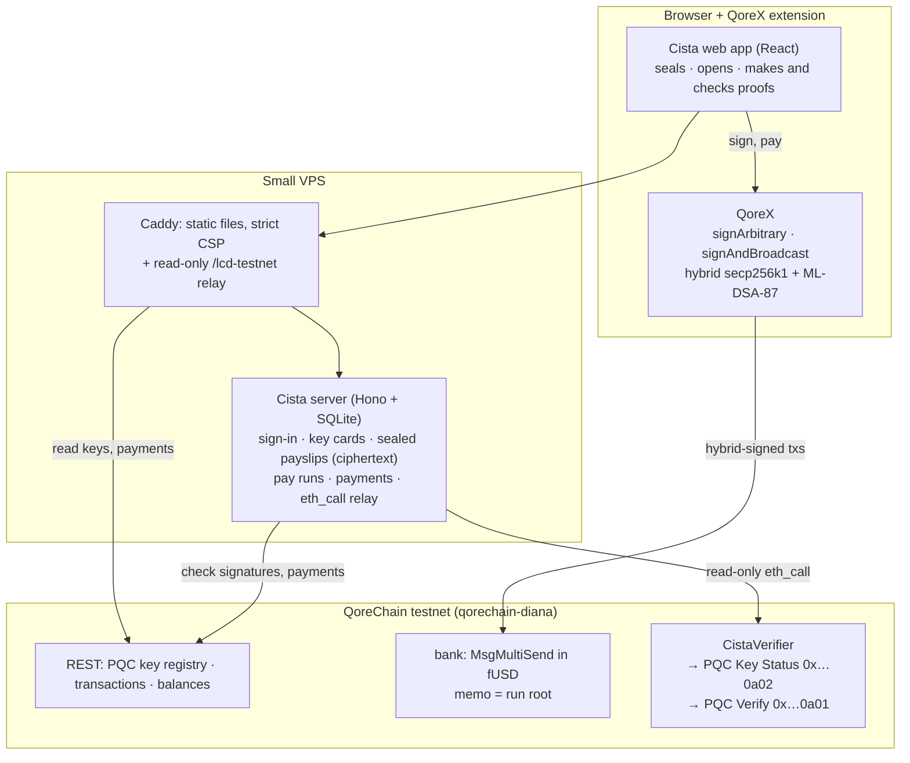

<p align="center">
  <picture>
    <source media="(prefers-color-scheme: dark)" srcset="docs/brand/cista-wordmark-dark.svg">
    
  </picture>
</p>

# Cista

[](https://build.qorechain.io/p/cista)

**Sealed payroll on QoreChain: everyone gets paid, only you see your payslip.**

Cista runs payroll on QoreChain. Payslips are sealed with ML-KEM-1024 in the employer's browser before they go anywhere. One hybrid-signed transaction pays the whole team in fUSD. And an employee can prove one fact about their pay (who employs them, that they earn at least $2,500 a month, that they earn between $2,500 and $3,000) to a lender or landlord without handing over the payslip. The lender checks it with no wallet, and a contract can check it on chain.

- **Try it:** https://cista.duckdns.org (QoreChain testnet; sign in with the QoreX browser extension)
- **Built for:** [Build Before Q-Day](https://build.qorechain.io), the **Encrypted Apps** track
- **Proven on testnet:** real pay runs, a contract checking the employer's real QoreX signature on chain, and a Q-Day drill with 8 of 8 attacks refused. See [Proven on testnet](#proven-on-testnet) and [audit.md](audit.md).

## Contents

- [The problem](#the-problem)
- [What Cista does](#what-cista-does)
- [Try it in five minutes](#try-it-in-five-minutes)
- [How a pay run works](#how-a-pay-run-works)
- [Proof of pay](#proof-of-pay)
- [On-chain proof of income](#on-chain-proof-of-income)
- [Keys, recovery and re-sealing](#keys-recovery-and-re-sealing)
- [Proven on testnet](#proven-on-testnet)
- [How it compares](#how-it-compares)
- [Why it matters for Q-Day](#why-it-matters-for-q-day)
- [Trust model and limits](#trust-model-and-limits)
- [Architecture](#architecture)
- [Run it](#run-it) · [Deploy](#deploy) · [Credits](#credits)

## The problem

A payslip is one of the most sensitive files a company holds: salary, tax, pension, role, start date. On a public chain, paying salaries normally publishes them. Encrypting them with today's public-key cryptography only delays that: anything copied now can be opened once a quantum computer breaks the key exchange ("harvest now, decrypt later").

Confidential payroll fixes the first part but makes a new problem. Employees still have to prove their income to banks, landlords and embassies, and a confidential salary is one nobody else can verify. A developer on Zama's own forum put it plainly: with FHE payroll, ["the salary is confidential… but unverifiable to third parties"](https://community.zama.org/t/confidential-payroll/4350). Today the employee's only option is to hand over the whole payslip, which shows far more than the lender needs and is easy to fake.

## What Cista does

| For | What they get |
| --- | --- |
| **Employers** | A team table (or a CSV), five steps: check everyone's keys and the balance, sign the pay run once in QoreX, seal and upload the payslips, pay everyone in one transaction, and have the payment checked on chain. Next month, start from any earlier run: the employer's key opens its own sealed copy and fills the table in. Year-to-date totals add themselves up. Re-seal past payslips for an employee who lost their key. |
| **Employees** | Payslips that open only in their browser, each checked against the pay run their employer signed, with pay frequency and the year so far. A proof of pay made in three steps: what to prove, who it's for and until when, and a preview of exactly what they will see. Unlock with a passkey instead of a password. |
| **Lenders and landlords** | A link that opens a check page: plain sentences ("Net pay for 2026-11 was at least $2,500.00 and less than $3,000.00"), who the proof was made for, every check that passed, and a "Check on chain" button. No wallet, no account. |
| **Other contracts** | `CistaVerifier`, a contract that checks the same proof with QoreChain's own post-quantum precompiles. |

## Try it in five minutes

You need Chrome with QoreX on testnet (in the extension, tap the version number 7 times, then "Switch to testnet (diana)"), two QoreX accounts, and some test fUSD and QOR for the one that pays ([faucet](https://dashboard.qorechain.io/faucet)).

1. **Both accounts, on My key:** sign in with QoreX, make a key (write down the 24-word recovery phrase), then sign and publish the key card.
2. **Employer, on Run payroll:** add the other account to the team with a small salary, then press through Check, Sign the run, Seal and upload, and Pay.
3. **Employee, on My payslips:** open the payslip, then under Prove your pay pick "Income in a range", name who it's for, and sign.
4. **Anyone:** open the link. Press "Check on chain" to have the contract check it too.

## How a pay run works

```
payslip fields ──salted SHA-256──▶ field commitments ──Merkle──▶ slip root   (one per payslip)
slip roots     ──────────────────────────────────────Merkle──▶ run root    (one per pay run)
```

1. **The employer builds the pay run in the browser.** Every payslip field (net pay, tax, pension, role, start date, payout address, "net pay is at least $2,500"…) is committed on its own with a 32-byte salt, so each can later be shown alone. Amounts are integers in cents.
2. **The employer signs the run in QoreX** (`signArbitrary`, hybrid secp256k1 + ML-DSA-87). What they sign is readable text: chain, employer, period, number of payslips, total payout, run root.
3. **Each payslip is sealed** with QoreSeal (ML-KEM-1024 + X25519) to the employee and to the employer. The envelope is bound to its chain, employer, period, employee and run root, padded to a fixed size, and doesn't say who it's for. Only after the employee's key card checks out against their ML-DSA-87 key on chain.
4. **One transaction pays the team:** a `MsgMultiSend` of fUSD from QoreX, hybrid-signed, with `cista:v1:<run root>` in its memo. The server records it only once the chain shows it pays exactly the signed total, from the employer, with the employer's ML-DSA-87 signature verified.
5. **The employee opens their payslip** in the browser and checks it against the signed run root.

**Money.** Payslips are in US dollars and paid in fUSD, the fest's dollar stablecoin, one to one, as stablecoin payrolls do (Bron's [confidential payroll on Ethereum](https://www.zama.org/solutions/confidential-onchain-payroll) paid in USDT). fUSD is an ERC-20 token that also exists on QoreChain's native lane as the bank denom `erc20:0x97143B771D34ddb9130b807b135Ae675A5a963CA` (6 decimals), so one `MsgMultiSend` from QoreX pays everyone. Fees are paid in QOR.

## Proof of pay

The employee picks one of the verification types lenders and landlords already ask for (the industry splits them into verification of employment and verification of income), or a custom set of lines:

| Proof type | Shows | Never shows |
| --- | --- | --- |
| **Employment** | employer, role, employed since, on the payroll for the period | any pay |
| **Income above an amount** | employer, period, "net pay is at least $X" | the amount |
| **Income in a range** | employer, period, "at least $X" and "less than $Y" | the amount |
| **Earned this year** | employer, period, "net pay so far this year is at least $X" | the total |
| **Exact pay** | net and gross pay, and the payment that reached the employee on chain | anything else |
| **Custom** | the lines the employee ticks, grouped as Employment, Pay, Year to date, Paid on chain, Payslip lines | the rest |

Every payslip answers "is net pay at least $X?" for a ladder of 23 bands from $250 to $50,000 a pay period, so a range is one band answered yes plus the next answered no. It also carries year-to-date gross, deductions and net, added up from the employer's own copies of earlier paid runs that calendar year, and answers 17 year-to-date bands from $5,000 to $500,000. The proof also always shows the employee's account and the currency.

The employee signs each proof for a named recipient and an expiry date (both in the signed text). The check page, with no wallet:

1. the shown fields come from one payslip in the pay run, unchanged;
2. the employee signed the proof with their registered ML-DSA-87 key, for this recipient, and it hasn't expired;
3. the employer signed the pay run with their registered ML-DSA-87 key;
4. the proof and the signed run are the same run;
5. the chain paid that run, hybrid-signed by the employer (and, if shown, the payout reached the employee).

The proof travels in the link's `#fragment`, which browsers don't send to any server.

## On-chain proof of income

[`CistaVerifier`](packages/contracts/contracts/CistaVerifier.sol) lets another contract (a lending pool, a rental deposit, a credit line) check a Cista proof itself, without trusting Cista, its server or the person submitting it:

```solidity
(address employer, address employee) = verifier.verifyFields(run, employerPqSignature, slipIndex, slipSiblings, fields);
require(employee == msg.sender, "not your payslip");
// then read the revealed fields, e.g. "net.atLeast.250000" == "yes"
```

`verifyFields` rebuilds the text the employer signed, gets the employer's ML-DSA-87 key from the PQC Key Status precompile (`0x…0a02`), checks the signature with the PQC Verify precompile (`0x…0a01`), then checks each field's salted commitment up the two Merkle trees to the signed run root. It holds nothing, stores nothing and has no owner; it reverts rather than passing when a precompile isn't there. A check costs about 330,000 gas, almost all of it the ML-DSA-87 verification. It uses the same construction as the TypeScript library, kept in step by shared test values. The check page's "Check on chain" button asks it the same question.

## Keys, recovery and re-sealing

- **Keys come from a 24-word recovery phrase,** shown once (QoreSeal's standard derivation from a BIP-39 phrase). It is not the QoreX seed phrase and holds no funds: it only opens payslips.
- **The phrase is checked before it counts:** three of its words are asked back once it's off screen, so a phrase that wasn't written down is caught at once.
- **A password locks a copy in the browser** with Argon2id (64 MiB, 3 passes, RFC 9106; AES-256-GCM; bound to the account). Argon2id is memory-hard, which makes guessing on graphics cards expensive, and it runs in plain JavaScript, so the strict CSP needs no WebAssembly exception. Vaults made earlier with PBKDF2 (600,000 rounds) still open and are re-locked with Argon2id on their next unlock. New passwords get a strength meter; weak ones are refused.
- **Or a passkey** (Face ID, Touch ID, Windows Hello, a security key): the WebAuthn PRF extension gives a secret only after the person is verified, and HKDF turns it into the AES key that wraps the seed in that browser. Nothing goes to the server; the password and the phrase keep working.
- **Once unlocked,** the key stays unlocked in that tab only, wrapped by a non-extractable WebCrypto key, until the tab closes or sits idle for 30 minutes.
- **Forgot the password?** The phrase rebuilds the same key, and every payslip opens again (the model [Proton uses](https://proton.me/support/recover-encrypted-messages-files) for data recovery).
- **Lost both?** The employee makes a new key, and the employer presses Re-seal: they open their own copy of each payslip and seal it again to the new key.
- **Key cards.** Each person publishes a QoreSeal recipient card: their ML-KEM-1024 key's SHA3-256 and their X25519 key, signed in QoreX. Employers only seal to cards that verify against the employee's ML-DSA-87 key registered on chain, so a server that swaps in its own key is caught. (QoreX refuses `MsgRegisterKEMKey` from websites, "managed by the wallet itself", so the signed card carries the ML-KEM key; a key in the chain's KEM registry is used when an account has one and no card.)

## Proven on testnet

| What | Where |
| --- | --- |
| A pay run paid by QoreX with one `MsgMultiSend`, hybrid-signed (the chain reports `pqc_hybrid_verify … status=verified` for the employer), run root `aa1868d9…4ce1` in its memo | [`F205402C…7A6FDF`](https://explore.qore.network/tx/F205402C3F9EABF2E393F5D83B71EE1E016791516F3F3B8356D7E15E787A6FDF), block 10,442,970, 20 Nov 2026 |
| A pay run paid in **fUSD** by QoreX with one `MsgMultiSend` of the native denom `erc20:0x9714…63CA` (10 fUSD), hybrid-signed, run root `47f10efc…649f` in its memo | [`A3978B6A…780DA5`](https://explore.qore.network/tx/A3978B6A03093FCBF862B3EC8538DFC4E799A7387E74F66C4140B769C6780DA5), block 10,502,279, 21 Nov 2026 |
| The employee opened each sealed payslip in the browser and made proofs (employer, period and net pay; employment, made for a loan) that passed every check, with no wallet | https://cista.duckdns.org/verify |
| A payslip sealed to a replaced key, re-sealed by the employer and opened again by the employee | Re-seal on the fUSD run |
| `CistaVerifier` deployed (a 1-transaction EVM window opened with a hybrid signature, then the deployment) | [`0xF269…19d8`](https://explore.qore.network/address/0xF26924d19029d1F1A253a3e079b16fD68B8519d8), tx `0xbbde1593…a49b2`, block 10,503,663 |
| The chain's PQC precompiles verified the employer's real QoreX signature on the fUSD run inside `CistaVerifier`; the same run with the total raised by one unit was refused (`BadSignature`) | `pnpm --filter @cista/contracts deploy:testnet`, 333,239 gas |
| Q-Day drill: an attacker with only a stolen classical key tried 8 attacks on the chain, the server, a forged proof and the contract; all 8 were refused | [docs/qday-drill.md](docs/qday-drill.md) |

The first run paid in QOR; pay runs now pay in fUSD.

## How it compares

| | Payslip content | Pay amounts on chain | Prove income to a third party | Third party needs | Tied to the real payment | Post-quantum |
| --- | --- | --- | --- | --- | --- | --- |
| Plain on-chain payroll | public | public | show the transactions | an explorer | yes | no |
| Zama / Bron FHE payroll | no payslip: the amount only | encrypted | time-limited decryption for another wallet, [planned](https://community.zama.org/t/confidential-payroll/4350); the value itself is revealed | a wallet | — | FHE (lattice-based) |
| [X-PACT](https://github.com/X-PACT/confidential-payroll) (Zama submission) | encrypted | encrypted | yes/no for a range the employee picks, decrypted by Zama's gateway | an Ethereum address | points to the run | FHE (lattice-based) |
| Employment-verification services | held by the service | — | the whole salary record, shared by the employer | an account, a fee | no | no |
| **Cista** | **sealed (ML-KEM-1024 + X25519)** | public | **any lines, a band or a range; signed for one recipient, with an expiry** | **nothing (or a contract call)** | **yes** | **ML-KEM-1024, ML-DSA-87** |

**The honest trade-off.** Zama and Bron's payroll ([the first on Ethereum mainnet](https://www.zama.org/post/the-first-confidential-payroll-on-ethereum-mainnet)) hides the *amount* with an FHE token (cUSDT, ERC-7984) and has no payslip. Cista is close to the mirror image: it seals the whole payslip and proves facts from it, but each person's **net pay is visible in the payment**, because QoreChain's bank transfers are public. Anyone who already knows an employee's address can read their net pay per period; nobody learns who they are, their gross pay, tax, deductions or role from the chain. In exchange Cista needs no FHE network, and its proofs need no wallet on the other side. If QoreChain adds confidential tokens, Cista can pay in them and keep everything else as it is.

## Why it matters for Q-Day

Payslips have a long shelf life: a salary history copied today is still sensitive in ten years. Cista seals them with ML-KEM-1024 (with X25519, so both would have to fall), and every signature that matters is ML-DSA-87, checked against the key registered on chain:

- An attacker who recovers an account's classical key can't pay, sign in, sign a pay run, publish a key card or make a proof. The [Q-Day drill](docs/qday-drill.md) tried all of these live: 8 of 8 refused.
- A copy of Cista's database holds only ML-KEM-1024 envelopes.
- Every proof can be re-checked on chain by the chain's own post-quantum precompiles.

## Trust model and limits

Full detail in [audit.md](audit.md). In short:

- **Payment amounts are public,** like every transfer on chain: someone who knows an employee's address can read their net pay per period. Who the employee is, gross pay, tax, deductions, role and personal details stay sealed.
- **One QoreX account is one company,** because proofs name the employer's address. Teams within a company share the account and each keeps its own runs to start from.
- **About 120 people per pay run** fit in one transaction (QoreX caps gas at 5,000,000; the hint is 150,000 + 40,000 a person). A larger team would need the run split into several payments, which isn't built.
- **The server** knows which addresses an employer pays and when, and can withhold payslips. It can't read them, swap keys, move envelopes or forge payments without being caught.
- **The browser is the trust boundary:** a hacked server could serve a changed web app. "Check on chain" and `CistaVerifier` let a lender rely on the contract instead.
- **Pay bands are fixed in advance** (23 of them); any range at all would need a zero-knowledge proof.
- **If both the employee and the employer lose their keys and phrases,** nobody can open those payslips. That's what sealing means.

## Architecture



| Path | What it is |
| --- | --- |
| `packages/core/src/payslip.ts`, `codec.ts` | The payslip model and its strict JSON form; amounts as integers |
| `packages/core/src/commit.ts`, `merkle.ts`, `run.ts` | Salted field commitments, the padded SHA-256 Merkle tree, slip and run roots, the memo and the signed statement |
| `packages/core/src/seal.ts` | Sealing and opening payslips with QoreSeal, bound to their place, padded |
| `packages/core/src/disclose.ts`, `sign.ts`, `verify.ts` | Selective disclosure, the signed proof statement, and the full check a lender runs |
| `packages/core/src/payment.ts`, `bankmsg.ts`, `network.ts` | Reading the payment from the chain; encoding `MsgMultiSend` / `MsgSend` for QoreX; the REST chain reader |
| `packages/core/src/recovery.ts`, `vault.ts`, `signin.ts` | The 24-word recovery phrase, the Argon2id key vault, the sign-in statement |
| `packages/contracts/contracts/CistaVerifier.sol` | The on-chain check; on testnet at [`0xF269…19d8`](https://explore.qore.network/address/0xF26924d19029d1F1A253a3e079b16fD68B8519d8) |
| `packages/contracts/scripts/deploy.ts`, `qday-drill.ts` | Deploy and check against a real run; the live Q-Day drill |
| `apps/server/src/app.ts`, `db.ts` | The API (sign-in, key cards, pay runs, re-seal, payments, inbox, eth_call relay) and its SQLite store |
| `apps/web/src/lib/qorex.ts` | QoreX: connect, sign text, send messages |
| `apps/web/src/lib/keys.ts`, `tabkey.ts`, `passkey.ts` | Keys from the phrase, unlock, recover, start over; staying unlocked in the tab; passkey unlock (WebAuthn PRF) |
| `apps/web/src/lib/strength.ts`, `phrasecheck.ts` | The password-strength estimate; asking the phrase back |
| `apps/web/src/lib/payroll.ts`, `payrun.ts`, `reseal.ts`, `history.ts` | The team table to payslips; the five pay-run steps; re-sealing; starting from an earlier run and the year so far |
| `apps/web/src/lib/fields.ts`, `onchain.ts` | Proof types and plain-language claims; the "Check on chain" call |
| `apps/web/src/pages/` | Home, My key, Run payroll, My payslips (with the proof maker), Check a proof |
| `deploy/` | Caddy site, systemd unit and a one-command VPS setup |
| [`audit.md`](audit.md), [`docs/qday-drill.md`](docs/qday-drill.md) | The security audit and the live drill results |

## Run it

Node 22.13 or newer and pnpm 10.

```bash
pnpm install
pnpm test                               # core, server, web and contract tests (238)
pnpm --filter @cista/server start       # server on http://127.0.0.1:8787
CISTA_DOMAIN=localhost:5173 pnpm --filter @cista/server start   # for local development
pnpm --filter @cista/web dev            # http://localhost:5173 (proxies /api and /lcd-testnet)
```

The server takes `CISTA_PORT`, `CISTA_DB`, `CISTA_DOMAIN`, `CISTA_REST`, `CISTA_CHAIN_ID`, `CISTA_EVM_RPC` and `CISTA_VERIFIER` from the environment. It needs no keys or secrets: it signs nothing.

The browser check of the proof page needs Playwright: `pnpm --filter @cista/web build && pnpm --filter @cista/web preview`, then `pnpm --filter @cista/web e2e:verify`.

Testnet scripts, from a **throwaway** testnet account in the git-ignored `packages/contracts/.env.seed` (`E2E_MNEMONIC="…"`):

```bash
pnpm --filter @cista/contracts deploy:testnet    # deploy CistaVerifier and check it against a real run
pnpm --filter @cista/contracts qday:drill        # the live Q-Day drill
```

## Deploy

On a VPS that already runs Caddy, with Node.js 22.13 or newer and a DuckDNS name pointing at it, run as root:

```bash
bash <(curl -fsSL https://raw.githubusercontent.com/phoenix-2203/cista/main/deploy/setup.sh)
```

It builds the web app, runs the server as a hardened systemd service under its own user (on the first free port from 8787, or `CISTA_PORT`), and adds a Caddy site with a strict Content-Security-Policy. Other sites on the server are left alone. Run it again to update.

## Credits

Open source libraries and QoreChain kits Cista uses:

| Library | Licence | Used for |
| --- | --- | --- |
| [@qorechain/qoreseal](https://github.com/qorechain/qoreseal) | Apache-2.0 | ML-KEM-1024 + X25519 sealing and signed recipient (key) cards |
| [@qorechain/qoresign](https://github.com/qorechain/qoresign) | Apache-2.0 | Checking hybrid secp256k1 + ML-DSA-87 signatures; reading registered keys |
| [@qorechain/sdk](https://www.npmjs.com/package/@qorechain/sdk) and [@qorechain/evm](https://www.npmjs.com/package/@qorechain/evm) | Apache-2.0 | The testnet scripts: hybrid-signed EVM windows, the deployment, the Q-Day drill |
| [@noble/hashes](https://github.com/paulmillr/noble-hashes) | MIT | SHA-256 and HMAC for field commitments and the Merkle tree |
| [@scure/bip39](https://github.com/paulmillr/scure-bip39) | MIT | The 24-word recovery phrase |
| [Hono](https://github.com/honojs/hono) and [@hono/node-server](https://github.com/honojs/node-server) | MIT | The server's HTTP API |
| [React](https://github.com/facebook/react) and [Vite](https://github.com/vitejs/vite) | MIT | The web app |
| [viem](https://github.com/wevm/viem) | MIT | Encoding the `CistaVerifier` call; contract calls in the scripts |
| [solc](https://github.com/ethereum/solc-js) | MIT (compiler only) | Compiling `CistaVerifier` |
| [@ethereumjs/evm](https://github.com/ethereumjs/ethereumjs-monorepo) | MPL-2.0 (tests only) | Running the contract tests on a local EVM |
| [tsx](https://github.com/privatenumber/tsx) | MIT | Running the TypeScript server and scripts |
| [Vitest](https://github.com/vitest-dev/vitest) and [TypeScript](https://github.com/microsoft/TypeScript) | MIT, Apache-2.0 | Tests and type checking |

The server's store uses `node:sqlite`, built into Node.js. AI use is documented in [AI_USAGE.md](AI_USAGE.md).

## Licence

MIT
